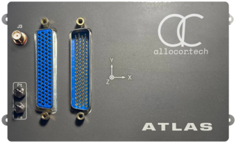
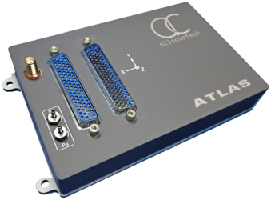
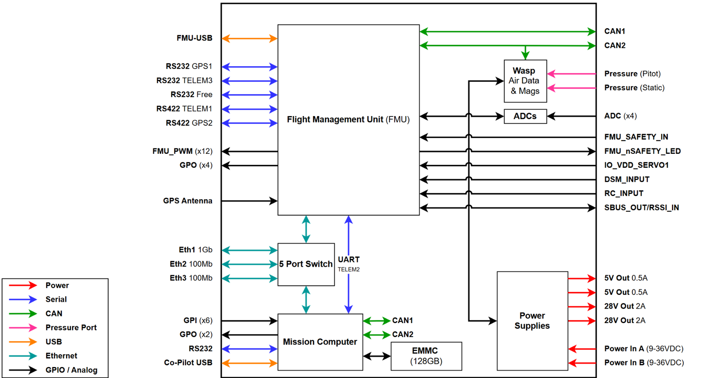
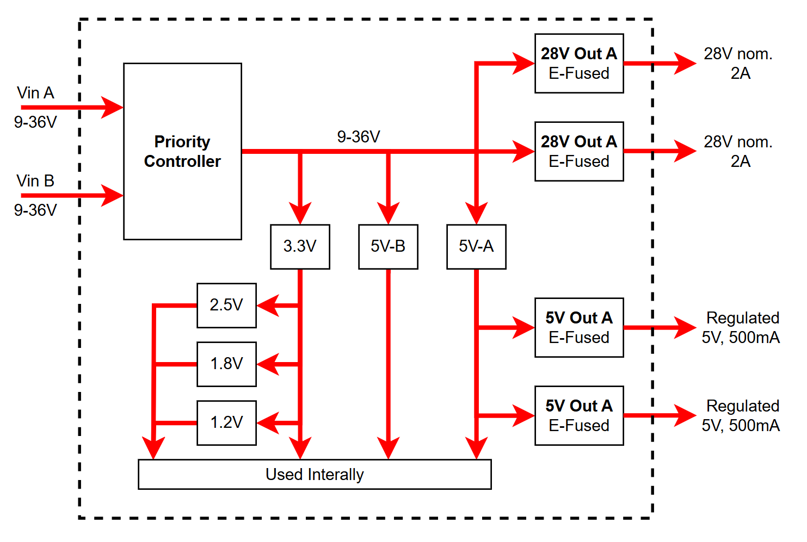
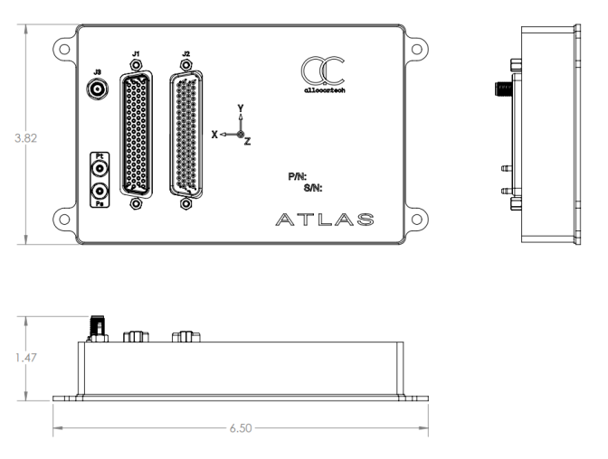
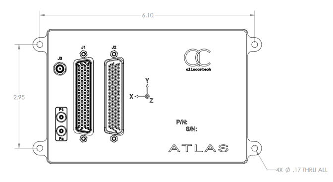
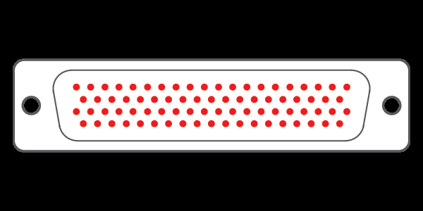

# Allocortech Atlas Flight Computer

::: warning
PX4 does not manufacture this (or any) autopilot.
Contact the [manufacturer](https://allocor.tech) for hardware support or compliance issues.
:::

The USA-built Atlas Flight Computer is a low-cost, ruggedised flight computer based on the [Pixhawk FMUv6X open source standard](https://github.com/pixhawk/Pixhawk-Standards).
In addition to the flight management unit (FMU), it integrates a Linux mission computer, air data sensors, a 5-port Ethernet switch, and an internal GPS in a single enclosure.

It offers a wide variety of interfaces including RS-232, RS-422, CAN, Ethernet and PWM, allowing it to handle both flight and payload management.

 

::: info
This flight controller is [manufacturer supported](../flight_controller/autopilot_manufacturer_supported.md).
:::

<Badge type="tip" text="main (PX4 v2.0)" />

## Specifications {#specifications}

### Processors

- FMU processor: STM32H753II (Arm Cortex-M7, 480 MHz, 2 MB flash, 1 MB RAM)
- I/O processor: STM32F103
- Mission computer: [Toradex Verdin](https://www.toradex.com/computer-on-modules/verdin-arm-family) System on Module running Linux
  - Verdin AM62, 2 GB RAM, 16 GB eMMC

### Sensors

- Bosch BMI088 IMU
- Invensense IIM-42652 industrial IMU
- Invensense ICM-42688-P IMU
- Bosch BMM350 magnetometer
- Amphenol [AUAV-L30D](https://www.allsensors.com/hubfs/Product-Data-Sheets/DS-432.pdf) barometer and differential pressure sensor (static and pitot ports)
- Internal u-blox MAX-M10S GPS

### Other Features

- Integrated 5-port Ethernet switch
- Two redundant, prioritised power inputs
- E-fused power outputs
- Sensor heater

::: warning
The Atlas does not have heater over-temperature protection, and the heater can overheat the FMU.
The heater is controlled by PX4, and is off by default.
If you enable it by setting [SENS_EN_THERMAL](../advanced_config/parameter_reference.md#SENS_EN_THERMAL) to `1`, PX4 regulates the temperature to [HEATER1_TEMP](../advanced_config/parameter_reference.md#HEATER1_TEMP) (55 °C by default).
Contact Allocortech for details.
:::

### Part Number {#part_number}

This page describes the Atlas part number `100-0104-002`, which is the standard production configuration.

### Architecture {#architecture}

The Atlas combines three systems in one enclosure: the FMU, the mission computer and the Wasp sensor hub.
They are connected by an internal Ethernet switch and share a common power supply.



- **Mission computer:** connected to the FMU by the `TELEM2` serial link and the internal Ethernet switch.
- **Wasp:** a sensor hub on the `CAN2` bus.
  It provides the air data sensors, switches the output loads, monitors the input and system voltages, and selects between the internal and external GPS.
  It holds the [DroneCAN](../dronecan/index.md) configuration for the Atlas, so its parameters can be adjusted over CAN (see [Wasp Configuration](#wasp)).

### Interfaces {#interfaces}

- **RS-232:** 4
- **RS-422:** 2 (`TELEM1` and `GPS2`, both terminated)
- **CAN:** 2
- **PWM out:** 12
  - `PWM_OUT_1`-`8`: I/O processor (PX4 `MAIN` outputs)
  - `PWM_OUT_9`-`12`: FMU (PX4 `AUX` outputs)
- **General purpose out:** 6
  - `GPO_1`-`4`: FMU, PX4 `AUX` 5-8 (PWM capable)
- **General purpose in:** 6
- **Analog in (0-5 V):** 4
- **5 V, 500 mA out:** 2
- **28 V (nominal), 2 A out:** 2 (not regulated; follows the input voltage)
- **Ethernet:** internal 5-port switch connecting the FMU (10/100 Mb/s), the mission computer (1 Gb/s) and three external ports (one 1 Gb/s, two 10/100 Mb/s)
- **PX4IO/RC control signals:** 7
- **RC input:** through the I/O processor (see [Radio Control](#radio_control))
- **GPS 1PPS in:** 1
- **Debug USB:** 2
- **Storage (FMU):** 32 GB eMMC
- **Storage (Mission computer):** 128 GB eMMC
- **Parameter storage:** FM25V02A FRAM

### Electrical Data {#electrical_data}

- Input voltage: 9-36 V (28 V nominal)
- Power inputs: two, prioritised (`VIN-A` primary, `VIN-B` backup)
- Power consumption: <20 W, varies with configuration

::: warning
The Atlas does not report battery voltage or current to PX4.
Without a battery monitor, PX4 does not show the battery level and cannot trigger low-battery warnings or [battery failsafes](../config/safety.md#battery-failsafes).
To enable them, connect a [DroneCAN power monitor](../dronecan/index.md) to `CAN1` and set [UAVCAN_SUB_BAT](../advanced_config/parameter_reference.md#UAVCAN_SUB_BAT) to `2`.
:::

| Parameter                             | Min   | Nom  | Max    | Unit |
| ------------------------------------- | ----- | ---- | ------ | ---- |
| Input voltage                         | 9     | 28   | 36     | V    |
| Input current (Vin = 28 V, loads off) |       |      | 0.72   | A    |
| Input current (Vin = 28 V, loads on)  |       |      | 4.9    | A    |
| Input current (Vin = 9 V, loads off)  |       |      | 2.2    | A    |
| Input current (Vin = 9 V, loads on)   |       |      | 6.8    | A    |
| Input power (loads off)               |       |      | 20     | W    |
| Input power (loads on)                |       |      | 170    | W    |
| PWM output voltage                    | 0     |      | 5      | V    |
| PWM output impedance                  |       | 150  |        | Ω    |
| GPO voltage                           | 0     |      | 5      | V    |
| GPO impedance                         |       | 150  |        | Ω    |
| GPI V<sub>IH</sub>                    | 3     | 5    | 50     | V    |
| GPI V<sub>IL</sub>                    | 0     | 2    |        | V    |
| GPI impedance (constant current sink) | >1000 |      |        | Ω    |
| ADC input voltage                     | 0     |      | 5      | V    |
| `+5V_OUT-x` current                   |       | 500  | 750\*  | mA   |
| `+28V_OUT-x` current                  |       | 2000 | 3000\* | mA   |

\*E-fuse setpoint. Not recommended to exceed the nominal value.

::: warning
The E-fuses are set above the rated current limit.
Do not exceed the rated limit.
:::



### Mechanical Data {#mechanical_data}

- Dimensions: 6.5 x 3.82 x 1.47 in (165 x 97 x 37 mm)
- Mass: approx. 386 g (with enclosure)
- Operating temperature: -20 °C to 71 °C
- Storage temperature: -40 °C to 85 °C





## Where to Buy {#store}

Contact [Allocortech](https://www.allocor.tech/contact) (US).

## Pinouts {#pinouts}

| Connector | Description                                  | Type                                                   |
| --------- | -------------------------------------------- | ------------------------------------------------------ |
| J1        | PWM, serial comms, GPIO                      | DD78S3S600X (78-pin D-Sub, socket); mate DD78M00000/AA |
| J2        | Power in/out, Ethernet, CAN, USB, RC-IO, ADC | DD78M3S600X (78-pin D-Sub, pin); mate DD78S00000/AA    |
| J3        | GPS antenna                                  | SMA female                                             |



### J1: GPIO and Serial Comms

| Pin   | Name              | Origin           | Notes                              |
| ----- | ----------------- | ---------------- | ---------------------------------- |
| 1-8   | `PWM_OUT_1`-`8`   | I/O processor    | PX4 `MAIN` 1-8                     |
| 9-12  | `PWM_OUT_9`-`12`  | FMU              | PX4 `AUX` 1-4                      |
| 13-16 | `GPO_1`-`4`       | FMU              | PX4 `AUX` 5-8 (PWM capable)        |
| 17-18 | `GPO_5`-`6`       | Mission computer |                                    |
| 19    | `FREE-232-TX`     | FMU              | `TELEM4` in PX4                    |
| 20    | `FREE-232-RX`     | FMU              | `TELEM4` in PX4                    |
| 21-39 | `GND`             |                  |                                    |
| 40-45 | `GPI_1`-`6`       | Mission computer |                                    |
| 46    | `TELEM3-232-TX`   | FMU              |                                    |
| 47    | `TELEM3-232-RX`   | FMU              |                                    |
| 48    | `GPS1-232-TX`     | FMU              |                                    |
| 49    | `GPS1-232-RX`     | FMU              |                                    |
| 50    | `TORADEX-232-TX`  | Mission computer |                                    |
| 51    | `TORADEX-232-RX`  | Mission computer |                                    |
| 52    | `TELEM1-422-TX_P` | FMU              |                                    |
| 53    | `TELEM1-422-TX_N` | FMU              |                                    |
| 54    | `TELEM1-422-RX_P` | FMU              |                                    |
| 55    | `TELEM1-422-RX_N` | FMU              |                                    |
| 56    | `GPS2-422-TX_P`   | FMU              |                                    |
| 57    | `GPS2-422-TX_N`   | FMU              |                                    |
| 58    | `GPS2-422-RX_P`   | FMU              |                                    |
| 59    | `GPS2-422-RX_N`   | FMU              |                                    |
| 60-66 | `GND`             |                  |                                    |
| 67    | `H_MCU_Recovery`  | Wasp             |                                    |
| 68    | `GND`             |                  |                                    |
| 69    | `H_EEPROM_1WIRE`  | Wasp             |                                    |
| 70    | `GND`             |                  |                                    |
| 71    | RFU               |                  | Reserved for future use            |
| 72    | `GND`             |                  |                                    |
| 73-75 | RFU               |                  | Reserved for future use            |
| 76    | `GPS_PPS_P`       |                  | 1PPS input from external GPS, LVDS |
| 77    | `GPS_PPS_N`       |                  | 1PPS input from external GPS, LVDS |
| 78    | `GND`             |                  |                                    |

### J2: Power, Ethernet, CAN

| Pin   | Name                 | Origin           | Notes                                 |
| ----- | -------------------- | ---------------- | ------------------------------------- |
| 1     | `ETH1_A_P`           | Ethernet switch  | 1 Gb/s port                           |
| 2     | `ETH1_A_N`           | Ethernet switch  |                                       |
| 3     | `ETH1_B_P`           | Ethernet switch  |                                       |
| 4     | `ETH1_B_N`           | Ethernet switch  |                                       |
| 5     | `ETH1_C_P`           | Ethernet switch  |                                       |
| 6     | `ETH1_C_N`           | Ethernet switch  |                                       |
| 7     | `ETH1_D_N`           | Ethernet switch  |                                       |
| 8     | `ETH1_D_P`           | Ethernet switch  |                                       |
| 9     | `ETH2_TX_P`          | Ethernet switch  | 10/100 Mb/s port                      |
| 10    | `ETH2_TX_N`          | Ethernet switch  |                                       |
| 11    | `ETH2_RX_N`          | Ethernet switch  |                                       |
| 12    | `ETH2_RX_P`          | Ethernet switch  |                                       |
| 13    | `ETH3_RX_N`          | Ethernet switch  | 10/100 Mb/s port                      |
| 14    | `ETH3_RX_P`          | Ethernet switch  |                                       |
| 15    | `ETH3_TX_N`          | Ethernet switch  |                                       |
| 16    | `ETH3_TX_P`          | Ethernet switch  |                                       |
| 17    | `GND`                |                  |                                       |
| 18    | `CAN1_N`             |                  |                                       |
| 19    | `CAN1_P`             |                  |                                       |
| 20    | `GND`                |                  |                                       |
| 21    | `+5V_OUT-A`          |                  | 500 mA max recommended, 750 mA E-fuse |
| 22    | `GND`                |                  |                                       |
| 23    | `+5V_OUT-B`          |                  | 500 mA max recommended, 750 mA E-fuse |
| 24    | `GND`                |                  |                                       |
| 25    | `+28V_OUT-A`         |                  | 2 A max recommended, 3 A E-fuse       |
| 26    | `GND`                |                  |                                       |
| 27    | `+28V_OUT-B`         |                  | 2 A max recommended, 3 A E-fuse       |
| 28    | `GND`                |                  |                                       |
| 29    | `F_USB_P`            | FMU              |                                       |
| 30    | `F_USB_N`            | FMU              |                                       |
| 31    | `F_VBUS_SENSE`       | FMU              |                                       |
| 32    | `GND`                |                  |                                       |
| 33    | `T_USB1_VBUS`        | Mission computer |                                       |
| 34    | `T_USB1_ID`          | Mission computer |                                       |
| 35    | `T_USB1_D_P`         | Mission computer |                                       |
| 36    | `T_USB1_D_N`         | Mission computer |                                       |
| 37-39 | `GND`                |                  |                                       |
| 40-43 | `VIN-A`              |                  | Primary power input                   |
| 44-47 | `GND`                |                  | Input power ground                    |
| 48-51 | `VIN-B`              |                  | Backup power input                    |
| 52    | `GND`                |                  |                                       |
| 53    | `F_FMU_SAFETY_IN`    | FMU              |                                       |
| 54    | `F_FMU_nSAFETY_LED`  | FMU              |                                       |
| 55    | `F_IO_VDD_SERVO1`    | FMU              |                                       |
| 56    | `F_DSM_INPUT`        | I/O processor    |                                       |
| 57    | `F_RC_INPUT`         | I/O processor    |                                       |
| 58    | `F_SBUS_OUT_RSSI_IN` | I/O processor    |                                       |
| 59    | `F_nARMED`           | FMU              |                                       |
| 60-63 | `VIN-A`              |                  | Primary power input                   |
| 64-67 | `GND`                |                  | Input power ground                    |
| 68-71 | `VIN-B`              |                  | Backup power input                    |
| 72    | `GND`                |                  |                                       |
| 73    | `CAN2_N`             |                  | Shared with the Wasp                  |
| 74    | `CAN2_P`             |                  | Shared with the Wasp                  |
| 75-78 | `ADC_IN0`-`3`        | FMU              | 0-5 V                                 |

### J3: GPS Antenna

| Pin  | Name  | Notes                                   |
| ---- | ----- | --------------------------------------- |
| Ring | `GND` |                                         |
| Pin  | `RF`  | Optional 3.3 V bias for active antennas |

## Building Firmware

To [build PX4](../dev_setup/building_px4.md) for this target:

```sh
make allocortech_atlas-v6x_default
```

## Serial Port Mapping

| UART   | Device     | Port                        |
| ------ | ---------- | --------------------------- |
| USART1 | /dev/ttyS0 | GPS1 (RS-232)               |
| USART2 | /dev/ttyS1 | TELEM3 (RS-232)             |
| USART3 | /dev/ttyS2 | Debug console               |
| UART4  | /dev/ttyS3 | TELEM4 (RS-232, `FREE-232`) |
| UART5  | /dev/ttyS4 | TELEM2 (mission computer)   |
| USART6 | /dev/ttyS5 | PX4IO (and RC input)        |
| UART7  | /dev/ttyS6 | TELEM1 (RS-422)             |
| UART8  | /dev/ttyS7 | GPS2 (RS-422)               |

## Radio Control {#radio_control}

RC input is connected to the I/O processor, not directly to the FMU.
The I/O processor decodes the RC signal and passes it to PX4 over the PX4IO link (`USART6`), in the same way as on other [Pixhawk FMUv6X](../flight_controller/pixhawk6x.md) boards.
Connect the receiver to `F_RC_INPUT` (PPM, S.Bus) or `F_DSM_INPUT` (Spektrum DSM) on `J2`.

Receivers that need a bidirectional UART, such as CRSF or GHST, cannot use the I/O processor input.
Connect them to a free serial port instead, and set [RC_PORT_CONFIG](../advanced_config/parameter_reference.md#RC_PORT_CONFIG) to that port.

## Wasp Configuration {#wasp}

The Wasp is a [DroneCAN](../dronecan/index.md) node on the `CAN2` bus, with node ID `100` by default.
It publishes the air data and magnetometer readings to PX4, and its parameters control the power outputs, GPS selection and CAN termination.

### Enable DroneCAN

To use the Wasp sensors, enable the PX4 DroneCAN driver and the matching sensor subscriptions:

1. In _QGroundControl_ set [UAVCAN_ENABLE](../advanced_config/parameter_reference.md#UAVCAN_ENABLE) to `2` (or `3` if you also use [DroneCAN ESCs](../dronecan/escs.md)) and reboot.
2. Enable the subscriptions for the Wasp sensors:
   - [UAVCAN_SUB_BARO](../advanced_config/parameter_reference.md#UAVCAN_SUB_BARO): barometer
   - [UAVCAN_SUB_DPRES](../advanced_config/parameter_reference.md#UAVCAN_SUB_DPRES): differential pressure (airspeed)
   - [UAVCAN_SUB_MAG](../advanced_config/parameter_reference.md#UAVCAN_SUB_MAG): magnetometer (enabled by default)
3. Reboot the vehicle.

DroneCAN configuration in PX4 is explained in more detail in [DroneCAN > PX4 Configuration](../dronecan/index.md#px4-configuration).

### Wasp Parameters

The Wasp parameters are set on the Wasp node, not on PX4.
They can be changed in _QGroundControl_ (see [DroneCAN > QGC CANNODE Parameter Configuration](../dronecan/index.md#qgc-cannode-parameter-configuration)), or with any DroneCAN tool such as the [DroneCAN GUI Tool](https://dronecan.github.io/GUI_Tool/Overview/).

::: warning
The Wasp only applies the output, GPS and termination parameters at startup.
After changing them, restart the Wasp node (for example from the DroneCAN GUI Tool) or power-cycle the Atlas.
:::

#### Power Outputs

| Parameter   | Output       | Default |
| ----------- | ------------ | ------- |
| `load_0_en` | `+28V_OUT-A` | 1 (on)  |
| `load_1_en` | `+28V_OUT-B` | 1 (on)  |
| `load_2_en` | `+5V_OUT-A`  | 1 (on)  |
| `load_3_en` | `+5V_OUT-B`  | 1 (on)  |

Set a parameter to `0` to disable the output, or `1` to enable it.
The outputs cannot be switched in flight: they are set once, when the Wasp starts.

#### GPS and CAN

| Parameter             | Description                                                                      | Default |
| --------------------- | -------------------------------------------------------------------------------- | ------- |
| `gps_sel_en`          | FMU GPS port source: `0` internal GPS, `1` external GPS.                         | 0       |
| `pps_sel_en`          | FMU 1PPS input source: `0` internal GPS, `1` external GPS.                       | 0       |
| `gps_ant_en`          | Enables the bias voltage on the `J3` GPS antenna connector, for active antennas. | 0 (off) |
| `can1_term_en`        | `CAN1` bus termination.                                                          | 1 (on)  |
| `can2_term_en`        | `CAN2` bus termination.                                                          | 1 (on)  |
| `dronecan_node_id`    | Wasp DroneCAN node ID (1-125).                                                   | 100     |
| `dronecan_mag_select` | Magnetometers to publish: `0` or `1` primary, `2` secondary, `3` all.            | 0       |

The Atlas ships with the internal GPS selected for both the GPS data and the 1PPS signal.

#### Power Monitoring

The Wasp can report the input voltages (`VIN`, `VIN-A` and `VIN-B`) as DroneCAN [CircuitStatus](https://dronecan.github.io/Specification/7._List_of_standard_data_types/#circuitstatus) messages.
Reporting is off by default; enable it with `circuit_report` (a bitmask of the circuits to report) and `dronecan_circuit_stat_hz` (the message rate).

::: info
PX4 does not use `CircuitStatus` messages, so these voltages are not shown in _QGroundControl_.
Use a DroneCAN tool such as the [DroneCAN GUI Tool](https://dronecan.github.io/GUI_Tool/Overview/) to view them.
:::
